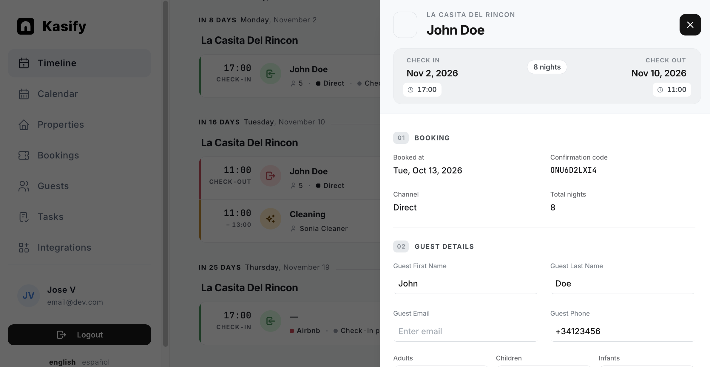

<p align="center">
  <picture>
    <source media="(prefers-color-scheme: dark)" srcset="docs/public/logo-dark.svg">
    
  </picture>
</p>

<h3 align="center">Open-source property management for short-term rentals</h3>

<p align="center">
  <a href="LICENSE"></a>
</p>

<p align="center">
  
</p>

Bookings from every channel in one calendar, guest check-in, Spanish legal compliance (SES Hospedajes), smart-lock access codes, and your cleaning and maintenance team, all in one place.

Kasify is built by short-term-rental hosts, for short-term-rental hosts. The hosted service lives at [kasify.eu](https://kasify.eu); this repository is the full application, which you can run yourself.

## What it does

- **Unified calendar.** Imports bookings from Airbnb, Booking.com, VRBO, Google and direct channels via iCal. One calendar for all your properties, with overlaps easy to spot.
- **Multi-property.** One account, many properties, each with its own calendar, team, tasks, integrations and permissions.
- **Online guest check-in.** Guests fill in their details before arrival from a link, no account needed.
- **Spanish guest registry (SES Hospedajes).** Submits the traveller registration the law requires, with retries, error classification and a local mock server for development.
- **Smart locks.** Generates and revokes per-booking access codes on Nuki and Unifi locks.
- **Team and tasks.** Invite managers, staff and external contractors with role-based visibility. Contractors never see guest personal data.
- **Guests.** Guest history across bookings, returning-guest detection.
- **HTTP API.** Everything the dashboard does is available through an authenticated API, with personal access tokens for scripts, internal tools and AI agents.
- **Notifications.** Email and Telegram, English and Spanish.

## Components

| Component | What it is | Stack |
|---|---|---|
| [`api/`](api/README.md) | Backend (port 8080) | Kotlin, Ktor, Exposed, Koin, PostgreSQL |
| [`dashboard/`](dashboard/README.md) | Web app (port 5173 in dev) | React 19, React Router v7 (SSR), Mantine, Tailwind CSS, i18next |
| [`docs/`](docs/README.md) | User guide and API reference | [Zudoku](https://zudoku.dev) |

Authentication is handled with [Kinde](https://kinde.com) (OAuth/OIDC). See [Authentication](#authentication) below.

## Getting started

### Quick start with Docker Compose

```bash
cp .env.example .env     # fill in your Kinde settings and set ENCRYPTION_KEY (openssl rand -base64 32)
docker compose up --build
```

Then open http://localhost:3000. The database is created and seeded on the first start. You still need a [Kinde](#authentication) application: add `http://localhost:3000` as its callback and logout URL.

### Running from source

#### Requirements

- JDK 21
- Node.js 24 (see `dashboard/.nvmrc`)
- PostgreSQL 17 (Docker is the easiest way)
- A Kinde application (free tier is fine), see [Authentication](#authentication)

#### 1. Database

```bash
docker run -d --name kasify-postgres -p 5432:5432 \
  -e POSTGRES_USER=postgres -e POSTGRES_PASSWORD=postgres \
  -e POSTGRES_DB=kasify postgres:17.10-alpine

docker exec -i kasify-postgres psql -U postgres -d kasify < api/db.sql
docker exec -i kasify-postgres psql -U postgres -d kasify < api/db_geo_seed.sql   # countries, provinces, municipalities
```

#### 2. API

```bash
cd api
cp .env.example .env
# Set DATABASE_*, KINDE_* and generate an encryption key:
./gradlew run --args="generate-key"   # paste the result into ENCRYPTION_KEY
./gradlew run                          # http://localhost:8080
```

Required variables are listed at the top of `api/.env.example`; the application refuses to start without them. Everything else (object storage, email, Telegram, SES credentials, rate limits) is optional and documented in the same file and in [`api/CLAUDE.md`](api/CLAUDE.md).

> [!NOTE]
> The official SES Hospedajes test server is often unavailable. To work on the Spanish guest registry locally, run the bundled mock (`cd api && ./gradlew runSesMock`) and start the API with `SES_ENDPOINT_URL=http://localhost:8888/hospedajes-web/ws/v1/comunicacion`. Error scenarios and options are documented in [`api/README.md`](api/README.md#ses-hospedajes-mock-server).

#### 3. Dashboard

```bash
cd dashboard
npm install
cp .env.example .env                   # then fill in your Kinde settings
npm run dev                            # http://localhost:5173
```

#### Useful commands

| Command | What it does |
|---|---|
| `cd api && ./gradlew test` | Backend tests |
| `cd api && ./gradlew ktlintFormat` | Format Kotlin |
| `cd dashboard && npm run typecheck` | TypeScript check |
| `cd api && ./gradlew runSesMock` | Local SES Hospedajes mock server (port 8888) |

## Authentication

Kasify currently delegates login to **Kinde** ([kinde.com](https://kinde.com), free tier is enough), so you need a Kinde account to run it: both the API (JWT validation, machine-to-machine token) and the dashboard (OAuth flow) are configured through it. 

In short, you need to create in Kinde:

- a **Back-end web** application for the dashboard login,
- two user properties, `k_uid` and `k_aid`, included in the access token,
- a **machine-to-machine** application (with the `update:user_properties` scope) so the API can write those properties after signup,
- optionally, an `admin` role.

Step-by-step instructions, the environment variables to fill in and troubleshooting are in [AUTHENTICATION.md](AUTHENTICATION.md).

## Self-hosting vs. the hosted service

The code in this repository is the complete application. The hosted service at kasify.eu runs it with a managed database, backups, monitoring and support. Self-hosting is fully supported, and the self-hosted app is not feature-limited.

## Contributing

Issues and pull requests are welcome. Please read [CONTRIBUTING.md](CONTRIBUTING.md) first. By submitting a contribution you agree that it is licensed under the same AGPL-3.0 license as the project.

Code style: ktlint for Kotlin (`./gradlew ktlintFormat`), strict TypeScript for the dashboard. See [`api/CLAUDE.md`](api/CLAUDE.md) and [`dashboard/CLAUDE.md`](dashboard/CLAUDE.md) for architecture notes (they are written for AI coding assistants, but read fine for humans).

## License

Kasify is licensed under the [GNU Affero General Public License v3.0](LICENSE). In short: you can use, modify and self-host it freely; if you offer a modified version as a network service, you must make your modifications available under the same license.

The Kasify name and logos are not covered by the code license; see [TRADEMARK.md](TRADEMARK.md).
